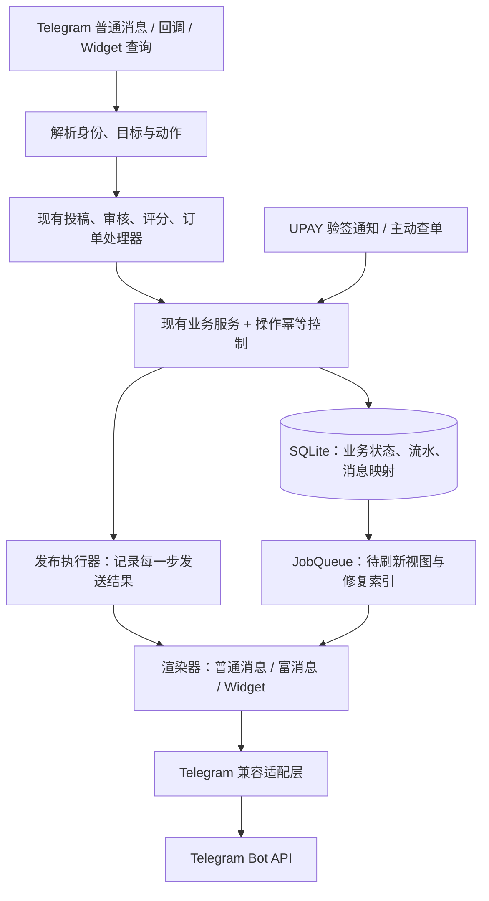
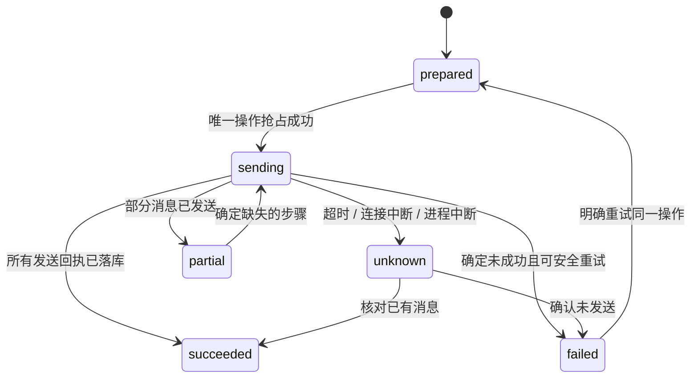

# TeleSubmit v2：Telegram Bot API 10.3–10.5 优化方案

日期：2026-11-23。状态：设计稿，可用于拆分开发任务；本文列出的模块、字段与开关均为拟新增项。

## 1. 推荐方案

分四阶段交付：**可靠操作与禁用按钮 → 频道个人临时反馈 → 富消息与搜索适配 → 私聊广告订单 Widget**。

首个开发批次采用 P0：集中兼容适配、按钮状态、审核原子处理、发布操作编号和广告账本幂等。P1–P3 在相应前置条件完成后独立开启。

沿用 Python、python-telegram-bot（PTB）、SQLite、aiohttp、JobQueue 和现有后台。复用投稿审核、UPAY、广告订单、评分和搜索服务，按功能增加少量模块。当前方案不引入新的服务进程、数据库或消息队列。

### 范围与优先级

| 阶段 | 用户收益 | 主要交付 | 开启条件 |
| --- | --- | --- | --- |
| P0 | 操作有反馈，重复点击不重复执行 | 禁用按钮、审核抢占、发布记录、幂等账本、统一回调目标 | 并发与超时恢复验证通过 |
| P1 | 在频道看个人结果，不干扰其他人 | 临时评分反馈、个人操作说明、私聊入口 | 回调兼容和 15 秒时限验证通过 |
| P2 | 内容与审核信息更易读，搜索保留完整内容 | 审核富消息、频道模板、块文本提取、普通文本视图 | 发布记录和索引适配通过 |
| P3 | 在一张订单卡片里查看支付进度 | 私聊订单 Widget、数据更新、原生按钮兜底 | 订单归属校验、账本幂等、消息映射完成 |

暂缓：AI 流式写稿停止按钮、TON 钱包支付、共享 Widget、群组 Widget、Inline Widget、自动启用私聊话题。现有 AI 是内部审核，不向投稿人展示模型推理或审核中间输出。

## 2. 已核实的约束与代码依据

### 2.1 官方能力边界

1. 2026-08-24，10.3：新增原生禁用按钮、正文按钮、紧凑表格、折叠引用、文件块，统一临时消息参数，并增加草稿生成停止事件。Rich Messages 和临时消息本身早于这次更新，本次属于增强。
2. 2026-11-09，10.4：新增 HTML Widgets；生产环境仅支持机器人私聊，自动保护内容，不能转发，不能由 `copyMessage/copyMessages` 复制，Inline 发送尚未开放。群组和转发场景只在测试服务器验证，不能列入本项目当前上线范围。
3. Widget 是固定 HTML/CSS/JS 加可变数据；没有网络访问，没有输入框、选择框、文本域和软键盘。HTML 发送后不可替换。原始 HTML ≤32768 字节，zlib level 9 压缩后 ≤4096 字节；`chat_data` 和 `public_data` 各 ≤1024 字节。
4. Widget 查询数据为 1–64 字节，每名用户对同一 Bot 的所有 Widgets 最多每 5 秒 5 次查询。每个查询必须在 15 秒内调用 `answerWidgetQuery`；回答本身不更新持久状态，需另外调用 `editMessageWidgetData`。
5. 10.4 的按钮临时回复可仅传 `callback_query_id`，省略 `receiver_user_id` 和 `chat_id`；频道直接消息聊天不支持。仍需调用 `answerCallbackQuery`，临时内容不保证送达，不能充当支付凭证或唯一通知。普通 Bot 对符合条件的动作回复存在 15 秒窗口。
6. 2026-11-22，10.5：新增 `setMySettings`、`BotFullInfo` 和回调目标模式；折叠富消息引用的内容字段由 `text` 改为 `blocks`。新设计统一使用当前 `blocks` 结构。
7. 检查当日 PyPI 最新 PTB 为 22.8，其版本 README 标注原生支持 Bot API 10.0，要求 Python ≥3.10；升级 SDK 不等于自动支持 10.3–10.5。项目锁定 21.10，Docker 为 Python 3.12，README 仍声明 Python 3.9+。

### 2.2 项目现状与设计影响

| 代码位置 | 观察 | 设计影响 |
| --- | --- | --- |
| `requirements.txt:2` | PTB 固定 21.10 | 新字段与新方法集中兼容；升级另做回归 |
| `ui/keyboards.py:164,228` | 页码和评分汇总使用 `page_info/rating_info` 回调 | 改用真正禁用的展示按钮，并保留旧回调应答 |
| `handlers/rating_handlers.py:149` | 更新键盘直接使用 `query.message` | 统一解析消息目标，兼容 `inline_message_id` 与不可访问消息 |
| `handlers/review_handlers.py:416` | 先读取 `pending`，随后按 ID 更新；未以条件更新抢占 | 多管理员竞态纳入 P0；属于代码风险分析，未声称发生线上重复发布 |
| `handlers/publish.py:208`、`handlers/review_handlers.py:568` | 普通发布和人工审核发布分两条路径 | 两者共用发布执行记录与渲染器，保留各自已有审核政策 |
| `utils/helper_functions.py:340` | 发送超时自动重试 | 频道发送需区分确定失败和结果未知，不能直接重试或降级重发 |
| `handlers/paid_ad_handlers.py:257` | 查单入口按订单号查单，未在此处校验点击者归属 | 新旧按钮与 Widget 共用带用户身份的查单入口 |
| `utils/paid_ad_service.py:202` | 唯一账本插入冲突后仍继续更新余额 | 将“新增流水成功”与余额变动绑定在同一事务；重复返回已有结果 |
| `utils/paid_ad_service.py:322` | 消费和退款流水未绑定发布操作编号 | 将扣次、退款与一次发布绑定，防止重复扣退 |
| `handlers/channel_listener.py:359` | 仅读取 `text/caption` | 富消息块需规范化提取，否则索引缺失正文或附件信息 |
| `main.py:450`、`utils/webhook_server.py:173` | 两处独立的更新类型白名单 | 统一生成；新增事件与处理器一起启用 |
| `utils/submit_settings.py` | 已有投稿配置快照 | 保存本次渲染策略，避免会话中途更换排版 |
| `handlers/paid_ad_notify.py` | 已有 UPAY 验签、入账与广告位通知 | 支付成功后触发卡片刷新，UI 刷新失败不回滚支付结果 |

本次只读源代码及公开文档，没有检查真实订单、日志或数据库记录。

## 3. 架构与兼容策略

### 3.1 消息与业务分离



对新 UI 的失败采取“业务结果保留、展示可重试”。对频道内容发送的失败采取“先确认是否已经发送，再决定是否重试”。

### 3.2 PTB 路线

- P0 先在隔离环境验证 21.10 的透传能力。已有方法、嵌套按钮的新字段使用 `api_kwargs`；接收的新字段通过原生属性优先、`api_kwargs` 后备读取。
- 新方法集中在 `utils/telegram_api.py`。21.10 没有已核实的公共 `Bot.do_api_request`；采用独立封装的原始 Bot API 请求客户端，复用 aiohttp 技术栈，统一超时、限流、异常与启动关闭生命周期。不要让业务模块依赖 PTB 的私有 `_post`。
- 原始客户端只允许本方案需要的方法；Bot API 地址和 Token 只从静态配置构建，禁止记录带 Token 的请求 URL。不改变 `getUpdates` 的获取进程。
- PTB 原生支持新方法后，只替换适配器内部实现。可以在独立批次将 22.8 作为升级候选，固定版本并回归；如通过升级，手动部署文档同步改为 Python ≥3.10。P0 不把 SDK 升级作为所有优化的硬前置。
- 原生消息对象和原始 JSON 都转换成小型内部 `MessageRef`/`SendResult`，业务端不猜测返回类型。
- 某些旧方法包装器仍将 `chat_id` 定义为必填，无法仅靠 `api_kwargs` 实现新协议的省略参数。此类临时回复也走集中原始请求适配，不传虚构聊天 ID。
- `getMe` 不返回 Bot API 版本号，也没有通用“支持 Widgets”开关。按已验证的能力配置启用，用专用测试 Bot 验证方法，不向生产频道发探测消息。

### 3.3 回调契约

`ActionContext = actor_user_id + callback_query_id + MessageRef + entity_id + session_id/revision`。

`MessageRef` 允许 `(chat_id,message_id)` 或 `inline_message_id`，二者择一；不可访问的消息不得当作完整 `Message` 使用。用户身份从 Telegram Update 获取，目标只能由服务端记录或实际更新解析。

临时消息另存 `EphemeralRef(chat_id,receiver_user_id,ephemeral_message_id)`，供专用编辑方法使用，不混用普通消息 ID。无法取得完整临时目标时，仅发送新的合格临时回复，不尝试编辑公共原帖。

各动作先鉴权；采用单一应答入口，快操作直接反馈，慢操作目标 2 秒内先应答“正在处理”。超过 15 秒的工作由已持久化的操作记录或视图刷新任务继续完成。不能在等待数据库 30 秒锁超时后才回答 Widget 查询。

默认保持 `callback_query_mode=default`。迁移中处理器要同时认识两种目标；只有覆盖全部编辑、评分、分页路径后，才由管理员明确应用新的模式。启动不自动调用 `setMySettings` 改变隐私、入群、话题或 Bot 互通权限。

## 4. P0：可靠操作与原生禁用按钮

### 4.1 按钮规范

| 场景 | 正常状态 | 进行中 | 完成 / 错误 |
| --- | --- | --- | --- |
| 评分 | 1–5 星可点击 | 个人反馈“正在保存” | 公共汇总更新；个人结果独立 |
| 汇总、页码 | 禁用展示按钮 | 无动作 | 点击不产生新查询 |
| 投稿确认 | 确认发布、返回修改、取消 | 发布中；本次确认失效 | 成功提供原帖链接；失败可恢复；未知提示核对 |
| 人工审核 | 通过、拒绝、拒绝并拉黑 | 审核抢占成功后显示处理中 | 显示最终审核人与时间 |
| 查单 | 查询支付状态 | 当前用户的查单按钮短暂禁用 | 已入账禁用；未确认允许再次查询 |

`InlineKeyboardButton` 的动作字段只选择一个。原生展示按钮使用 `disabled={}`，不同时携带 `callback_data`。旧服务端明确拒绝该字段时，可降级为 `ui_noop` 并立即应答。旧消息中的 `page_info/rating_info` 继续识别。

禁用状态不能代替后端校验。频道评分按钮不因某个用户已投票而对所有人禁用；点击者的已评分状态放在临时反馈里。后台原子处理不得以键盘编辑成功为前提。

“拒绝并拉黑”增加一次确认，显示目标投稿人；取消返回审核卡片。拉黑副作用失败时显示“已拒绝，拉黑未完成”，不伪报全部完成。

### 4.2 发布状态与重试

新投稿创建随机 `session_id`，每次内容修改增加 `revision`。确认按钮绑定二者，旧预览不能发布后续新稿。重复审核的键使用 `review:{review_id}`，普通稿使用 `submit:{session_id}:{revision}:{destination}`。



- 发布前持久化内容和业务快照，再抢占唯一操作；调用 Telegram 前释放数据库写锁。
- 每个发送步骤先记 `sending`，成功立刻保存返回的消息 ID；媒体组作为一个发送步骤保存全部返回 ID。后续步骤失败时保留此前回执。
- 网络超时不能证明 Telegram 未发送。出现 `unknown` 时停住后续重发、退款和格式降级，提示管理员核对；Bot API 没有通用消息发送幂等键，不承诺端到端 exactly-once。
- 应用重启后，遗留 `sending` 进入 `unknown`，不能自动恢复为可重试。租约只避免并行工作，不证明前一次发送失败。
- 确定不支持富消息、确定参数不合法且请求被拒绝时，才允许转普通模板；已有回执或超时后不自动降级重发。
- 只有收到并保存回执才告知“已发布”。索引更新失败属于后处理，按已存在消息 ID 修复索引，不重新发频道内容。
- 已知部分发布不自动整组重发，也不先退还广告次数。按步骤补齐或由管理员确认处理结果；未知结果解决后再决定结算。

### 4.3 审核抢占与账本

审核通过、拒绝使用条件更新：`UPDATE ... WHERE id=? AND status='pending'`，以 `rowcount==1` 判定本次获胜。通过动作的审核决定与唯一发布操作在同一短事务中建立；发布结果单独跟踪，避免把“审核通过”当成“发布成功”。

对多管理员发送的卡片记录消息映射；决定提交后刷新其他副本。即使某个副本未刷新，后台仍返回已处理结果。

广告流水增加可空唯一 `idempotency_key`：

- 购买：`purchase:{out_trade_no}`；同一事务内首次流水插入成功才增加余额和标记已支付。唯一冲突读取既有结果，不继续加余额；其他约束错误向上抛出。
- 发布消费：`consume:{publish_operation_id}`；余额条件扣减、消费流水与操作关联在同一事务。
- 退款：`refund:{publish_operation_id}`；仅对确定未发布的已扣次操作退款，最多一次。已有消费/退款流水会返回既有结果。

支付通知继续验签、校验金额；新旧查单入口均先校验订单归属。按钮只表示“请求查询”，不能因按钮名称“我已支付”而入账。保持已支付状态单向生效，过期视图不阻止迟到的合法到账核对。

## 5. P1：频道中的个人临时反馈

### 5.1 评分流程

1. 用户点击 1–5 星；后台按 `(subject_id,user_id)` 唯一约束保存或更新评分。
2. 对该回调及时应答；在有效窗口内发送仅当前用户可见的临时消息：“已评 4 星；当前平均 4.6，128 人参与”。
3. 临时面板可带“修改评分”“查看原帖”等动作，个人状态不写进公共键盘。
4. 公共汇总按评分实体合并更新，目标同一消息每秒最多刷新一次（项目侧节流），以最新聚合结果为准，避免旧请求覆盖新汇总。

简短成功反馈仍可直接 `answerCallbackQuery`，不为每次点击强制生成一张面板。临时消息只在需要展示更多信息或个人操作时使用。

### 5.2 反馈和降级

- 发送参数为 `ephemeral_message_parameters={callback_query_id: ...}`；首版不替换原频道帖子。个人面板自身后续编辑使用临时消息专用编辑方法。
- 评分授权以 Telegram 的真实 `from.id` 和后台记录为准；回调数据中的用户 ID 不作为依据。
- 临时消息不支持、已过有效窗口、用户离线时，已提交的评分保持成功。优先使用已准备好的普通回调应答；应答已经完成则不反复应答，必要时下次交互提示。
- 不把个人余额、订单详情降级成频道公开消息。需持久保留的个人通知发已授权的私聊；未启动私聊的用户提供 Bot 深链，不假设可以主动私聊。
- 临时消息不保证送达；审核结果、订单付款凭证、发布链接继续使用普通私聊消息。

## 6. P2：富消息模板与完整索引

### 6.1 两种模板，逐步开启

**审核卡片先行**：投稿标题与来源 → 原文摘要 → 可折叠的完整正文和 AI 审核结论 → 通过 / 拒绝 → 二次确认的拒绝并拉黑。提交给 AI 的内部提示词不展示。

**频道资源帖试点**：标题 → 摘要 → 标签与说明 → 折叠详情 → 最多一个已验证的文件块 → 原帖操作。评分行和可变广告位仍保留在外部 `reply_markup`，复用当前键盘更新方式。

首版只覆盖纯文本和单文件资源帖。多媒体组、混合附件和现有剧透行为先走原发布器；不要为统一外观拆掉现有媒体组。长正文需要完整保留时使用折叠块或经过分段的普通文本视图，不默默截断正文。

### 6.2 渲染与内容模型

规范内容模型 `PostContent` 包含标题、摘要、正文、标签、链接、附件、投稿人展示策略和模板版本。它属于业务数据，不依赖 Telegram 块 JSON。

同一份模型生成普通 HTML 消息和 `InputRichMessage.blocks`。使用当前 `expandable_blockquote.blocks`，紧凑表格只用于短字段。用户文字始终按文字编码，链接与附件类型经过验证；不把投稿人的任意 HTML 直接当作排版代码。

提供明确的“纯文本视图”私聊入口。无法可靠识别对方 Telegram 客户端版本，不以 `getMe` 或猜测版本判断每个阅读者是否支持富消息。

### 6.3 入站与搜索

新增纯函数 `normalize_message_content(message_or_json)`：

- 优先解析已知富消息块，递归提取段落、列表、表格、折叠内容、链接和文件名；保留合理换行。
- 未知块跳过并记录类型，继续处理已知内容，不因单块未知丢弃整条消息。递归深度和总字节数有限制。
- 普通 `text/caption` 是旧消息输入来源；两种表示同时存在时按规范去重，不把正文重复索引。
- 自有发布直接从 `PostContent` 建索引；频道监听和历史同步共用规范化函数。原始内容保存为可重建来源，Whoosh 继续为派生索引。
- 外部富消息的引用回复也进入规范化路径，按需解析 `quote.rich_texts`；引用片段不能代替全文。

评分实体识别、标签、文件名搜索和删除操作都沿用同一逻辑帖子 ID，富消息渲染版本不创建第二个评分实体。

## 7. P3：私聊广告订单 Widget

### 7.1 首版产品界面

先覆盖“购买广告次数”订单，验证后复用到广告位租期订单。每笔订单发送独立 Widget：`allow_queries=true`、`is_shared=false`、`public_data` 留空。私人订单不使用共享 Widget。

```text
广告发布套餐                         待支付
10 次广告发布                       20.00 USDT
订单 DEMO-1042 · 网络 TRC20
请按订单金额支付；剩余 14:32

[查询支付状态]   [复制金额]

普通消息说明：订单号、金额、网络、当前状态
[打开支付页] [复制收款地址] [查看余额]
```

上面的金额、网络和次数是交互示例，不代表生产套餐。真实显示使用创建订单时的冻结快照；不能用后来修改的套餐价格覆盖已有订单。

广告文案、链接仍通过现有聊天输入或后台编辑。Widget 内没有文本输入，不设计内嵌表单。首版支付页、复制地址和完整帮助保留原生键盘，Widget 只负责状态和少量操作。

### 7.2 状态约定

| 视图状态 | 文案 | 行为 |
| --- | --- | --- |
| waiting | 等待支付 | 可查单、打开支付页、复制金额 |
| checking | 正在核对支付 | 当前组件查单暂禁用，避免连点 |
| unconfirmed | 暂未确认到账 | 恢复查单；显示上次核对时间 |
| paid | 已到账，已增加 X 次 | 停止倒计时；查单变为禁用展示；提供余额 |
| window_ended | 支付时间已到，请先查询状态 | 不能因本机倒计时到零直接判定未付；避免引导继续付款 |
| unavailable | 查询暂不可用 | 已知状态保留，可稍后重试；不伪报未支付 |

Widget 内立即绘制 `chat_data`，无网络加载动画。倒计时是本地展示，不进行后台轮询。付款是否成功只由经验证的 UPAY 结果和服务端订单状态确认。

主题使用 Telegram 变量，按钮触控目标至少 44px；不依赖悬停、垂直拖动或键盘。遵循减少动态效果设置。当前 Widgets 的 ARIA 语义不可用，关键信息同时存在于 caption 和原生操作中。

### 7.3 请求与更新链路

1. 点击 → `TelegramWidget.request('check:<短引用>')`。请求内容最多 64 字节，不携带 Token、余额或完整表单。
2. 服务端验证查询类型、真实 `from.id`、消息归属与订单归属；不信任前端 `viewer` 或回传金额。初版只接受普通 data 查询。
3. 对相同订单的并行查单合并，用户侧设置短冷却；参考 Telegram 的每 5 秒 5 次上限，项目默认每用户每 2 秒接受一次主动查单。
4. 快查询在预留时限内完成则调用 `answerWidgetQuery` 返回结果，并更新 `chat_data` 和 caption。网关较慢则在 2 秒左右答复“已受理”，写入持久视图任务，由 JobQueue 继续查单并更新数据；任何路径不跨越 15 秒应答期限。
5. UPAY 合法通知提交入账事务后，写入同一持久视图任务；JobQueue 根据订单消息映射刷新 Widget 和普通说明。
6. 消息不存在、被删除或用户屏蔽 Bot：停止对应视图任务，保留付款结果。缺少 Widget 映射也不能阻止入账。

查询回答不是状态持久化。后端每次更新都递增视图 `revision`；组件忽略较旧 revision，防止通知、查单、刷新交错导致已支付退回未确认。

### 7.4 重启与内容限制

- `chat_data` 仅含渲染需要的订单短引用、当前状态、冻结金额/币种/次数、截止时间、revision 和最后核对时间，UTF-8 实际测量 ≤1024 字节。支付地址和支付 URL 首版放在原生键盘，不膨胀状态。
- `public_data` 不存私人订单资料。HTML 无真实用户信息或密钥，由版本化模板生成。
- 当前创建订单返回的实际收款金额、地址、网络尚非全部落库：P3 前补齐展示快照，否则重启后不能准确恢复二维码/金额。
- HTML 改版发送新卡片，旧卡片保留旧版本及兼容处理；不声称可以原地替换 HTML。
- 对明确不支持 Widget 或模板超限的拒绝，发送既有普通订单消息。发送超时归为结果未知，不自动重复发送；caption 和原生键盘为已经发送的 Widget 提供基础视图。
- Widget 不是独立支付工具，不访问 UPAY，也不接入 TON 签名或钱包转账。

## 8. 数据变更与模块

### 8.1 数据最小集合

所有变更使用编号、可重复执行的增量迁移；异常不能被宽泛 `except` 吞掉。迁移仅由未来实施批次执行，本设计阶段不打开生产数据库。

| 阶段 | 表 / 字段 | 约束与用途 |
| --- | --- | --- |
| P0 | `schema_migrations(version,applied_at)` | 编号唯一；记录本次升级迁移 |
| P0 | `submissions.session_id, revision` | 新会话随机编号；历史会话补号，旧确认需重新预览 |
| P0 | 新 `bot_operations` | `operation_key UNIQUE`，保存类型、实体、所有者、状态、内容快照、回执、时间、错误分类 |
| P0 | 新 `publish_parts` | `(operation_id,part_key) UNIQUE`，保存发送步骤的状态、消息 ID 列表、尝试时间 |
| P0 | `ad_credit_ledger.idempotency_key` | 可空唯一索引；新流水必须填；历史 NULL 不重算 |
| P0 | 新 `bot_message_views` | 业务类型/实体、所有者、消息目标、渲染类型、模板版本、已渲染 revision、失效标记；支持审核多个副本 |
| P2 | `published_posts` 可空附加字段 | `source_content_json`、`renderer`、`template_version`；旧文本与关联消息字段保留 |
| P3 | 两类订单新增展示快照 | 创建时实际 `pay_amount/pay_address/pay_type`，与原交易金额分别保存，不替代验签核对字段 |
| P3 | 新 `ui_refresh_jobs` | `(job_kind,entity_id) UNIQUE`，待执行状态、next_run、attempts、最新 revision；同订单合并，不靠内存任务保证恢复 |

`bot_message_views` 的普通目标有 chat/message ID，Inline 目标有 inline ID，使用互斥约束。私人订单视图绑定所有者；多管理员审核副本绑定审核实体和可访问管理员身份。

`pending_reviews.status` 保留审核决定的语义，发布是否成功从关联的 `bot_operations` 查询。新增唯一键不对历史账本重新计费；没有可靠历史关联的消费记录不猜测绑定关系。

### 8.2 模块清单

```text
utils/
  telegram_api.py             # 新方法、透传、限流、错误分类和生命周期
  telegram_capabilities.py    # 能力开关、统一 allowed_updates
  callback_context.py         # 身份和 MessageRef 规范化
  operation_service.py        # 抢占、幂等、账本关联
  publish_service.py          # 共用发送步骤与回执，不重复审核规则
  message_views.py            # 消息映射、刷新、删除失效
  content_normalizer.py       # 普通 / 富消息规范化、文本提取
  widget_service.py           # 订单卡片、查询和视图恢复
ui/
  rich_messages.py            # PostContent 的富消息模板
  widgets/order_v1.html       # 自包含的 Telegram Widget 模板
handlers/
  widget_handlers.py          # 新查询入口，鉴权后调用服务
database/migrations/
  001_telegram_ui_operations.py
  002_rich_message_sources.py
  003_order_widgets.py
```

新增文件随阶段创建，避免先堆空模块。既有 `paid_ad_service/slot_ad_service/rating_service/search_engine` 继续承载业务。普通发布与人工审核发布统一到执行器时，对原有扣次、审核豁免、剧透、评分、通知和指纹行为逐项回归。

## 9. 配置与上线控制

复用 `runtime_settings` 增加下列业务开关，后台可显示实际生效值和最近失败类别：

| 拟新增键 | 初始值 | 生效方式 |
| --- | --- | --- |
| `telegram_ui.disabled_buttons` | false，P0 验证后开启 | 新渲染生效；旧回调保留 |
| `telegram_ui.ephemeral_feedback` | false | 即时读取，限经过验证的场景 |
| `telegram_ui.rich_review` | false | 新审核卡片生效 |
| `telegram_ui.rich_posts` | false | 新投稿配置快照 |
| `telegram_ui.order_widgets` | false | 新私聊订单生效 |
| `telegram_ui.pilot_user_ids` | 空 | 仅允许名单用户看到实验渲染 |

开关同时满足本地支持、服务端已验证和业务范围后才生效。订单、已有消息和投稿保留创建时版本；关闭新卡片创建后，已发卡片的旧协议处理与查单入口继续工作。

`setMySettings` 先实现“读取与差异预览”，作为可选运维能力。未来只有明确应用配置时修改；首轮不自动开启话题侧栏、不关闭隐私模式、不改变入群权限。

兼容降级日志按 `feature + error_class + chat_type` 聚合，不记录 Token、完整订单状态或用户正文。区分 `unsupported`、`invalid_payload`、`forbidden`、`rate_limited`、`unknown_delivery`；不能把所有 BadRequest 都视为不支持，也不能因一个用户无权发送就全局禁用功能。

## 10. 开发任务与依赖

| 编号 | 工作包 | 依赖 | 可审查产物 |
| --- | --- | --- | --- |
| T0 | 兼容性试验 | 无 | 21.10 与候选 22.8 的能力矩阵、原始请求与未知字段验证；固定一种首批方案 |
| T1 | 操作、消息视图和增量迁移 | T0 | 唯一键、审核抢占、发布步骤回执、历史兼容 |
| T2 | 回调与按钮状态 | T0、T1 | 禁用展示按钮、旧回调兼容、双目标编辑、提示一致 |
| T3 | 支付与发布幂等收口 | T1 | 首次入账门闩、按操作扣退、订单归属、未知发送恢复 |
| T4 | 临时评分反馈 | T2 | 个人面板、频道隔离、15 秒窗口和降级 |
| T5 | 富消息审核及规范化 | T1、T2 | 两种渲染、块提取、未知块容错、搜索完整 |
| T6 | 频道资源模板试点 | T3、T5 | 纯文本/单文件发布、普通视图、多附件沿用现有路径 |
| T7 | 订单 Widget | T3、T2 | 冻结快照、查询处理、消息映射、刷新任务、尺寸预算 |
| T8 | 分阶段启用与运维说明 | 对应工作包 | 手动验收记录、功能开关、回退与核对说明 |

P0 交付范围为 T0–T3。先完成这一批，再按 T4 → T5/T6 → T7 的顺序扩展。代码目录当前存在多处已有修改，实施时以现有工作区为基础建立差异基线，避免覆盖既有功能。

## 11. 验收标准

以下是未来实现的必要验证，不表示本设计阶段已经执行。

### P0 必过

- 同一预览连续点击、重复 Update、两名管理员同时审核：一份稿件只产生一个获胜操作；失败竞争者拿到既有结果。
- 修改稿件后点击旧按钮：不发布新稿，不删除新会话，提示重新预览。
- Telegram 已接收但客户端超时、发出后进程退出：记录为未知，不自动重发、退款或切换格式；管理员可绑定已存在消息完成核对。
- 媒体组返回多个 ID、后续文档失败：回执保留，可按步骤处理，不整组重发。
- 同时通知与查单、重复合法支付通知：余额只增加一次；同一操作扣次和退款各最多一次。已有唯一流水冲突不能再次加余额。
- 订单编号被另一个用户提交：不给出订单详情、不调用该订单的查单/退款操作。
- 两种回调目标、不可访问消息、旧版按钮、图片 caption 均可处理；图片订单说明使用 caption 编辑，避免把所有订单都当文本消息编辑。
- 完整验证普通投稿、人工审核、付费广告、评分、广告位租期、搜索和定时发布的现有流程。

### P1 / P2 必过

- 两个用户点击同一频道帖子，各自只看到自己的反馈；公开汇总不包含个人订单或余额。
- 临时回复过期或失败不丢评分；持久通知仍能单独发送。
- 富消息的正文、折叠内容、中文标签、附件文件名可搜索；旧帖重建索引与新帖一致，不重复正文、不重复评分实体。
- 外部富消息包含未知块或异常深度时保留可识别内容；普通消息路径和旧客户端普通视图可用。
- 仅对明确被拒绝且确定未发送的请求降级；未知状态不重发。

### P3 必过

- HTML 和 UTF-8 状态边界用实际字节数检查，zlib level 9 压缩计数包含最终模板；无网络请求、外部脚本和表单输入。
- 每个 Widget 查询均在 15 秒内回答；延迟网关不占满回调处理，重复查询有冷却和合并。
- 已支付状态不会被旧 revision 覆盖；本地倒计时不把订单直接判为支付失败。
- 重启后从订单快照、消息映射和刷新任务恢复；支付回调与 UI 更新失败互不回滚。
- 卡片删除、Bot 被屏蔽、模板版本变化、不支持 Widget、1024 字节超限均有确定处理。
- 当前生产只启用私聊；群组和 Inline 的测试服通过不能作为生产开放依据。

### 检查方式

有风险的状态与账本使用 SQLite 临时库并发测试；解析与渲染使用固定 JSON 样本；网络错误用可控制的测试客户端。再用专用 Bot 和管理员私聊验证真实 API、移动端与桌面端。测试禁止接入真实支付或生产频道发送。

发布前运行受影响测试并完成现有回归，保存结果。监测“未知发送数、重复动作拦截数、查单失败类别、视图刷新积压、回调应答耗时”，它们是工程验收指标，不是已有生产测量。

## 12. 回退与交付边界

回退先关闭新渲染开关，保留已有新消息的查询处理、事务和账本修正。优先采用支持新字段但使用普通 UI 的兼容构建；不能简单退回不认识新操作和唯一键的旧程序。数据库迁移以追加为主，保留新列和记录；不对生产做破坏性降级。

未知发送、部分发送、迟到支付属于需要核对的业务记录，必须在切换版本前保留并交接。服务端数据是真实来源，Widget、键盘和索引是可重建展示。

本轮交付是设计文档与可交互的方案预览，预览使用虚构示例数据和本地状态切换，不连接 Telegram、UPAY 或生产数据库。

预览文件：[Telegram 优化交互预览](prototypes/telegram-bot-api-upgrade.html)。

## 参考资料

- [Telegram Bot API 10.3，2026-08-24](https://core.telegram.org/bots/api-changelog#august-24-2026)
- [Telegram Bot API 10.4，2026-11-09](https://core.telegram.org/bots/api-changelog#november-9-2026)
- [Telegram Bot API 10.5，2026-11-22](https://core.telegram.org/bots/api-changelog#november-22-2026)
- [Telegram Bot API 方法与类型](https://core.telegram.org/bots/api)
- [Telegram Widgets：限制、状态与查询](https://core.telegram.org/bots/widgets)
- [PTB 22.8 README：Bot API 10.0、Python 3.10+](https://github.com/python-telegram-bot/python-telegram-bot/blob/v22.8/README.rst)
- [PTB 前向兼容说明](https://github.com/python-telegram-bot/python-telegram-bot/wiki/Bot-API-Forward-Compatibility)
- [PTB PyPI 元数据](https://pypi.org/pypi/python-telegram-bot/json)

官方限制与 SDK 信息核实于 2026-11-23。后续开发时重新确认生产开放范围，不能直接把测试服务器能力作为生产支持。
